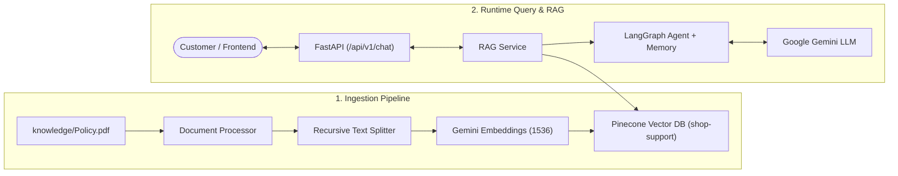

# 🛍️ SnapStore Customer Support AI (RAG Agent)

A production-ready Retrieval-Augmented Generation (RAG) Customer Support assistant for **SnapStore**. Built with **FastAPI**, **LangGraph**, **Pinecone Vector Database**, **Google Gemini**, and a responsive **Tailwind CSS** chat frontend.

---

## 🌟 Key Features

- **Document Grounded (RAG):** Retrieves accurate store policies, return windows, warranty clauses, and customer conditions directly from indexed PDF documentation.
- **Strict Guardrails & Refusal Rules:** Strictly ignores off-topic requests (coding, personal advice, general knowledge) and refuses prompt injection attempts.
- **LangGraph Checkpointer State:** Maintains conversation context across turns using memory-checkpointed agent architecture.
- **Vector Search with Pinecone:** Fast, serverless vector similarity search using Google Generative AI embeddings (1536 dimensions).
- **Modern Chat Frontend:** Fully responsive chat UI with markdown rendering, suggested question pills, typing indicators, and one-click copy buttons.
- **Production REST API:** Clean FastAPI endpoints with CORS middleware, health checks, and automatic OpenAPI Swagger documentation.

---

## 🏗️ Architecture Overview



---

## 📂 Repository Structure

```
├── agent/
│   ├── graph.py               # LLM, embeddings, checkpointer, and agent definition
│   └── prompt.py              # System prompt, guardrails, and refusal rules
├── api/
│   └── v1/
│       └── chat.py            # FastAPI chat router (POST /api/v1/chat)
├── frontend/
│   ├── index.html             # Responsive chat interface (Tailwind CSS)
│   ├── style.css              # Custom scrollbars, animations, and markdown styling
│   ├── app.js                 # Frontend API client and state management
│   └── README.md              # Frontend specific documentation
├── knowledge/
│   └── Policy.pdf             # Raw store policy document for ingestion
├── model/
│   └── query_chat.py          # Pydantic schemas for request/response validation
├── services/
│   ├── document_processor.py  # PDF loader and text splitter
│   ├── rag_service.py         # RAG pipeline logic and message orchestration
│   └── retrieval_service.py   # Pinecone vector store client and search
├── .env.example               # Template for environment variables
├── .gitignore                 # Preconfigured git ignore rules
├── ingest.py                  # Script to process and index Policy.pdf into Pinecone
├── pine.py                    # Helper script to initialize Pinecone index
├── main.py                    # FastAPI application entry point and CORS setup
└── requirements.txt           # Python dependencies
```

---

## 🚀 Getting Started

### 1. Prerequisites
- **Python 3.10+** (Tested on Python 3.11)
- **Google AI Studio API Key:** [Get Gemini API Key](https://aistudio.google.com/)
- **Pinecone Account & API Key:** [Get Pinecone Key](https://app.pinecone.io/)

### 2. Clone the Repository
```bash
git clone https://github.com/<your-username>/<your-repo-name>.git
cd <your-repo-name>
```

### 3. Create and Activate Virtual Environment
```bash
python3 -m venv .venv
source .venv/bin/activate    # On Windows: .venv\Scripts\activate
```

### 4. Install Dependencies
```bash
pip install -r requirements.txt
```

### 5. Configure Environment Variables
Copy the example environment file:
```bash
cp .env.example .env
```
Open `.env` and fill in your API credentials:
```env
GOOGLE_API_KEY=your_gemini_api_key_here
PINECONE_API_KEY=your_pinecone_api_key_here
INDEX_NAME=shop-support
```

---

## 📥 Ingestion & Index Setup

If your Pinecone index is not created yet, create it using:
```bash
python pine.py
```

Then, chunk and upload your policy document (`knowledge/Policy.pdf`) into Pinecone:
```bash
python ingest.py
```
*Expected output: `Successfully stored 14 chunks in Pinecone.`*

---

## 🖥️ Running the Application

### 1. Start the FastAPI Backend
```bash
uvicorn main:app --reload --port 8000
```
- API Base URL: `http://127.0.0.1:8000`
- Interactive Swagger Docs: `http://127.0.0.1:8000/docs`
- Health check: `http://127.0.0.1:8000/`

### 2. Launch the Frontend
You can run the frontend in any of the following ways:

- **VS Code Live Server (Port 5500):** Right-click `frontend/index.html` and select **"Open with Live Server"**.
- **Python HTTP Server:**
  ```bash
  python -m http.server 5500 --directory frontend
  ```
  Visit [http://localhost:5500](http://localhost:5500).
- **Direct Browser File:** Double-click `frontend/index.html` in your file explorer.

---

## 📡 API Reference

### Health Check
`GET /`
```json
{
  "status": "online",
  "service": "SnapStore Support AI API",
  "chat_endpoint": "/api/v1/chat",
  "docs": "/docs"
}
```

### Chat with Support Assistant
`POST /api/v1/chat`

**Request Body:**
```json
{
  "query": "What is the return window for electronics?"
}
```

**Response:**
```json
{
  "response": "For Consumer Electronics & Gadgets (such as smartphones, laptops, smartwatches, cameras, and audio equipment), the return policy is as follows:\n\n* **Return Window:** 7 days from the delivery date.\n* **Condition Requirements:** Items must be in pristine, unactivated condition with manufacturer seals intact..."
}
```

---

## 🛡️ License
This project is open-source and available under the [MIT License](LICENSE).
