# SnapStore Customer Support AI (RAG Agent)

A production-ready Retrieval-Augmented Generation (RAG) Customer Support assistant for **SnapStore**. Built with **FastAPI**, **LangGraph**, **Pinecone Vector Database**, **Google Gemini**, **BM25 Hybrid Search**, and a responsive **Tailwind CSS** chat frontend.

---

## Key Features

- **Structure-Aware Chunking via Markdown:** Converts PDF documentation into structured Markdown via PyMuPDF4LLM and splits along semantic document headers (`#`, `##`, `###`) using `MarkdownHeaderTextSplitter`. Every chunk preserves its section hierarchy and breadcrumb metadata.
- **Hybrid Search with Reciprocal Rank Fusion (RRF):** Fuses sparse lexical BM25 keyword matching with dense semantic Pinecone vector similarity search for optimal document retrieval.
- **Document Grounded (RAG):** Retrieves store policies, return windows, warranty terms, shipping speeds, billing guidelines, and security requirements directly from 5 comprehensive store policy PDFs.
- **Strict Guardrails & Refusal Rules:** Strictly ignores off-topic queries (coding, personal advice, general knowledge) and refuses prompt injection attempts.
- **LangGraph Checkpointer State:** Maintains multi-turn conversation context across interactions using memory-checkpointed agent architecture.
- **Responsive Chat Frontend:** Clean chat interface with live markdown rendering, suggested query pills, typing indicators, and one-click copy buttons.
- **Production REST API:** Clean FastAPI endpoints with CORS middleware, lifespan index initialization, health checks, and interactive OpenAPI Swagger documentation.

---

## Architecture Overview

```mermaid
flowchart TD
    subgraph Ingestion ["1. Structure-Aware Ingestion Pipeline"]
        PDFs["knowledge/*.pdf (5 Policy PDFs)"] --> PyMu["Markdown Converter (pymupdf4llm)"]
        PyMu --> MD["Structured Markdown (#, ##, ###)"]
        MD --> Split["MarkdownHeaderTextSplitter"]
        Split --> SubSplit["Recursive Sub-Splitter (chunk_size=1000)"]
        SubSplit --> Meta["Breadcrumb & Section Metadata Enrichment"]
        Meta --> Pinecone["Pinecone Vector DB (Dense 1536)"]
        Meta --> BM25["In-Memory BM25 Index (Sparse Lexical)"]
    end

    subgraph Runtime ["2. Hybrid RAG Query & Agent Execution"]
        User(["Customer / Frontend UI"]) <--> API["FastAPI (/api/v1/chat)"]
        API --> Hybrid["Hybrid Search (BM25 + Pinecone)"]
        Hybrid --> RRF["Reciprocal Rank Fusion (RRF)"]
        RRF --> Context["Breadcrumb-Enriched Policy Context"]
        Context --> Agent["LangGraph Agent + Checkpointer"]
        Agent <--> Gemini["Google Gemini LLM"]
    end
```



---

## Repository Structure

```
├── agent/
│   ├── graph.py               # LLM, embeddings, checkpointer, and agent definition
│   └── prompt.py              # System prompt, guardrails, and refusal rules
├── api/
│   ├── dependencies.py        # FastAPI dependency injection for BM25 retriever
│   └── v1/
│       └── chat.py            # FastAPI chat router (POST /api/v1/chat)
├── frontend/
│   ├── index.html             # Responsive chat interface (Tailwind CSS)
│   ├── style.css              # Custom scrollbars, animations, and markdown styling
│   ├── app.js                 # Frontend API client and state management
│   └── README.md              # Frontend specific documentation
├── knowledge/
│   ├── Account_Security_and_Privacy_Policy.pdf   # 2FA, password, and privacy rules
│   ├── Payment_and_Billing_Policy.pdf            # Invoicing, gift cards, price match
│   ├── Policy.pdf                                # Master returns, refunds, exceptions
│   ├── Shipping_and_Delivery_Policy.pdf          # Delivery tiers, carrier claims, customs
│   └── Warranty_and_Repairs_Policy.pdf           # 1-year warranty, Care+ plans, RMA
├── model/
│   └── query_chat.py          # Pydantic schemas for request/response validation
├── scripts/
│   └── build_knowledge_pdfs.py # PDF generation script for sample knowledge documents
├── services/
│   ├── document_processor.py  # Structure-aware markdown extraction and chunker
│   ├── rag_service.py         # Hybrid search RRF and agent message orchestration
│   └── retrieval_service.py   # Pinecone vector store and BM25 index management
├── .env.example               # Template for environment variables
├── .gitignore                 # Preconfigured git ignore rules
├── ingest.py                  # CLI script to chunk and index PDFs into Pinecone
├── pine.py                    # Helper script to initialize Pinecone index
├── main.py                    # FastAPI application entry point, lifespan, and CORS
└── requirements.txt           # Python dependencies
```

---

## Getting Started

### 1. Prerequisites
- **Python 3.10+** (Tested on Python 3.11)
- **Google AI Studio API Key:** [Get Gemini API Key](https://aistudio.google.com/)
- **Pinecone Account & API Key:** [Get Pinecone Key](https://app.pinecone.io/)

### 2. Clone the Repository
```bash
git clone https://github.com/<your-username>/<your-repo-name>.git
cd <your-repo-name>
```

### 3. Create and Activate Virtual Environment
```bash
python3 -m venv .venv
source .venv/bin/activate    # On Windows: .venv\Scripts\activate
```

### 4. Install Dependencies
```bash
pip install -r requirements.txt
```

### 5. Configure Environment Variables
Copy the example environment file:
```bash
cp .env.example .env
```
Open `.env` and fill in your API credentials:
```env
GOOGLE_API_KEY=your_gemini_api_key_here
PINECONE_API_KEY=your_pinecone_api_key_here
INDEX_NAME=shop-support
```

---

## Ingestion & Vector Index Setup

### 1. Initialize Pinecone Index
If your Pinecone index is not created yet, initialize it using:
```bash
python pine.py
```

### 2. Ingest Policy Documents
Chunk and upload all PDFs in the `knowledge/` directory into Pinecone using structure-aware chunking:
```bash
python ingest.py
```
*Expected output: `Successfully stored 61 structure-aware chunks in Pinecone.`*

You can also re-generate or modify the sample knowledge base PDFs at any time:
```bash
python scripts/build_knowledge_pdfs.py
```

---

## Loading Your Own Knowledge Base (Custom PDFs)

The `knowledge/` directory contains 5 comprehensive policy PDFs designed for an e-commerce platform. You can easily add your own company documents.

### How Structure-Aware Chunking Works
1. **Markdown Extraction:** `pymupdf4llm` scans your PDF and converts visual headings into standard Markdown (`# Title`, `## Section`, `### Subsection`).
2. **Structural Boundaries:** `MarkdownHeaderTextSplitter` splits strictly along heading boundaries rather than slicing sentences arbitrarily.
3. **Breadcrumb Metadata:** Every chunk is enriched with `Header 1`, `Header 2`, `Header 3`, `source`, `filename`, and a unified `section` path (e.g. `Shipping Policy > Domestic Shipping > Express Air`).
4. **Adaptive Sub-Splitting:** Any section exceeding `chunk_size` is sub-split at sentence boundaries while preserving full header metadata.

### Method 1: Add or Replace PDFs in `knowledge/`
1. Place any new `.pdf` files directly inside the `knowledge/` folder.
2. Run the ingestion command:
   ```bash
   python ingest.py
   ```

### Method 2: Specify a Single PDF Path
To index a single document without touching the rest:
```bash
python ingest.py path/to/your_document.pdf
```

### Method 3: Adjust Chunking Parameters
Fine-tune chunk boundaries in `services/document_processor.py`:
```python
chunks = processor(
    path="knowledge",
    chunk_size=1000,      # Max characters per section chunk
    chunk_overlap=150     # Overlap between consecutive sub-chunks
)
```

---

## Running the Application

### 1. Start the FastAPI Backend
```bash
uvicorn main:app --reload --port 8000
```
- API Base URL: `http://127.0.0.1:8000`
- Interactive Swagger Docs: `http://127.0.0.1:8000/docs`
- Health check: `http://127.0.0.1:8000/`

Upon startup, the server automatically builds the in-memory BM25 index over all documents in `knowledge/`.

### 2. Launch the Frontend
You can run the frontend in any of the following ways:

- **VS Code Live Server (Port 5500):** Right-click `frontend/index.html` and select **"Open with Live Server"**.
- **Python HTTP Server:**
  ```bash
  python -m http.server 5500 --directory frontend
  ```
  Visit [http://localhost:5500](http://localhost:5500).
- **Direct Browser File:** Double-click `frontend/index.html` in your file explorer.

---

## API Reference

### Health Check
`GET /`
```json
{
  "status": "online",
  "service": "SnapStore Support AI API",
  "chat_endpoint": "/api/v1/chat",
  "docs": "/docs"
}
```

### Chat with Support Assistant
`POST /api/v1/chat`

**Request Body:**
```json
{
  "query": "What is the screen repair deductible under SnapStore Care+?"
}
```

**Response:**
```json
{
  "response": "The screen repair deductible is $29.00 USD for smartphones, tablets, and smartwatches under SnapStore Care+."
}
```

---

## License
This project is open-source and available under the [MIT License](LICENSE).
